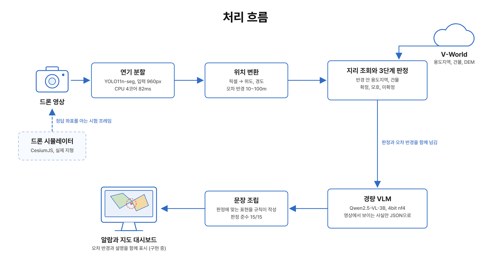

<div align="center">

# 엣지아이 (EdgeEye)

**드론 영상에서 산불 연기를 찾고, 위치 오차를 고려한 지리 정보와 함께 경량 VLM이 상황을 한국어로 설명하는 시스템**

2026 2학기 캡스톤디자인2 (진행 중)

[📄 중간 발표자료 (PDF)](docs/제출본/발표자료.pdf) | [📂 실험 문서](docs/) | [📊 실험 결과](results/)

&nbsp;&nbsp;&nbsp;&nbsp;

</div>

<br>

## 📌 프로젝트 개요

| 항목 | 내용 |
|---|---|
| 기간 | 2026.09 ~ 진행 중 |
| 인원 | 3명 (모델과 해설, 시스템과 시연, 데이터와 지리) |
| 과목 | 명지대학교 캡스톤디자인2 |
| 진행 상황 | 중간 발표 완료, 단계별 모델과 모듈 구현 중 |

드론이 찍은 사진만으로는 연기가 정확히 어디서 났는지 알기 어렵다. 위치 오차가 수십 미터만 되어도 산림인지 주거지인지가 바뀐다.
그런데 VLM은 위치가 불확실해도 "주거지 인근에서 연기가 발생했다"처럼 단정해서 말한다.

이 프로젝트는 오차 반경 안의 토지 용도를 조회해 확정, 모호, 미확정으로 판정하고, 판정에 따라 VLM에 넘길 정보와 문장 표현을 다르게 해서 위치가 불확실할 때 단정하는 설명을 줄이는 것을 목표로 한다.

<br>

## ✨ 진행 현황

| 단계 | 내용 | 상태 |
|---|---|---|
| 데이터 선별 | AI Hub 71330 드론 사진 중 학습용 1,260장 선별 | 완료 |
| 연기 분할 | YOLO11n-seg 학습, 운영 설정 960px, conf 0.10 | 완료 |
| 위치 변환 | 픽셀을 위도, 경도와 오차 반경으로 변환 | 초안 완료, 시뮬레이터로 검증 중 |
| 지리 조회 | 반경 안 용도지역 비율, 건물, 경사 조회 | 완료 |
| 판정 임계값 | 확정, 모호, 미확정을 가르는 기준값 실험 | 완료 |
| 경량 VLM | 후보 비교, 양자화 설정, Qwen2.5-VL-3B 선정 | 완료 |
| 설명 생성 | 생성 방식 3종 비교, 구조화 출력과 템플릿 선택 | 비교 완료, 구현 중 |
| 파이프라인 | 단계 연결과 알람 발행 | 진행 중 |
| 대시보드 | 알람과 오차 반경을 지도에 표시 | 진행 중 |

### 시연 화면

<!-- 대시보드와 시뮬레이터 화면이 나오면 캡처를 넣는다 -->
추가 예정

<br>

## 🏗 시스템 구조

<p align="center"></p>

### 기술 스택

| 구분 | 사용 기술 |
|---|---|
| 연기 분할 | Ultralytics YOLO11n-seg |
| 경량 VLM | Qwen2.5-VL-3B-Instruct 4bit (GPU: bitsandbytes, CPU: llama.cpp GGUF) |
| 지리 처리 | shapely, pyproj, V-World 2D 데이터 API |
| 시뮬레이터 | CesiumJS |
| 측정 기준 | CPU 4코어, 메모리 8GB (현장 기기 가정) |

<br>

## 📊 지금까지의 결과

### 연기 분할

데이터 양, 입력 해상도, 모델 크기를 하나씩 바꿔 다섯 번 학습했다.
mAP만으로는 작은 연기를 찾는지 알 수 없어서 사진 단위로도 쟀다.

학습 검증 세트, conf 0.25 기준이다.

| 설정 | 분할 mAP50 | 작은 연기 | 큰 연기 | 배경 헛탐지 |
|---|---|---|---|---|
| 300장, 640px | 0.298 | 47% | 87% | 50% |
| 1,260장, 640px | 0.544 | 62% | 93% | 10% |
| **1,260장, 960px (선택)** | **0.559** | **77%** | **98%** | **3%** |
| 1,260장, 1280px | 0.611 | 77% | 93% | 3% |

데이터를 늘린 것이 가장 크게 들었고, 해상도는 960px에서 탐지율이 더 오르지 않았다.
운영 문턱은 작은 연기를 놓치지 않도록 0.10으로 정했다(작은 연기 96%, 배경 헛탐지 11%).
자세한 내용은 [docs/train_results.md](docs/train_results.md)에 있다.

학습에서 뺀 장소(모래고개입구)의 평가셋 100장(6.2 확정본)으로 다시 재면 conf 0.10에서 연기 사진 64/70(91%)을 잡고,
큰 연기 61/67, 오탐 유발 사진 헛경보 5/30(모두 굴뚝연기, 구름 0/15)이다.
같은 도구로 잰 학습 검증 세트(재현율 97%, 큰 연기 99%)보다 낮아, 처음 보는 장소에서 성능이 떨어진다.
확정본에는 아주 작은 연기가 3장뿐이라 작은 연기 성능은 학습 검증 세트로 본다.
자세한 내용은 [docs/detect_eval.md](docs/detect_eval.md)에 있다.

### 핵심 비교: 한 점 조회와 반경 판정

위치 오차를 고려하면 틀린 용도를 단정하는 일이 주는지, 정답 좌표를 아는 발화점 600곳에서 쟀다.
시뮬레이터에서 잰 탐지 오차와 카메라 자세 잡음을 넣었다. 잡음의 크기는 가정한 값이고 반경 공식에도 같은 값을 썼다.
실제 비행으로 잰 값이 아니다.

| 방식 | 틀린 용도 단정 | 확정했을 때 정확도 | 확정 비율 |
|---|---|---|---|
| 한 점 조회 후 단정 | 18.3% | 81.7% | 100% |
| 자세 오차 항 없는 반경 + 판정 | 8.2% | 86.5% | 60% |
| **자세 오차 항을 넣은 반경 + 판정 (지금)** | **3.7%** | **92.4%** | 48% |

판정을 실제로 쓰는 200~400m에서는 자세 오차 항이 없는 반경(12.5%)이 한 점 조회(14.1%)와 거의 같았다.
반경이 카메라 기수와 각도 오차를 담지 못해 너무 작았기 때문이다. 그래서 반경 공식에 자세 오차 항을 넣었다(5.7%).
자세한 내용은 [docs/verdict_compare.md](docs/verdict_compare.md)에 있다.

### 설명 생성 방식

미확정일 때 용도 이름을 쓰지 말라는 지시를, 파일럿에서 프롬프트만으로는 6건 중 한 건도 지키지 않았다.
그래서 설명을 만드는 방식 세 가지를 평가셋 100장(6.2 확정본)으로 비교했다.

| 방식 | 판정 준수 | 과신률 | 요소 포함 | 장당 처리 시간 |
|---|---|---|---|---|
| 프롬프트만 | 50% | 37% | 65% | 9.4초 |
| 규칙 검증 후 재생성 | 83% | 14% | 64% | 20.3초 |
| **구조화 출력과 템플릿** | **100%** | **0%** | 51% | **6.5초** |

VLM은 영상에서 보이는 사실만 JSON으로 내고, 불확실성 표현은 규칙이 판정에 맞춰 문장으로 조립한다.
판정 준수 100%는 템플릿이 막아서 나온 값이고, 판정이 맞는지는 위 핵심 비교에서 따로 쟀다.
자세한 내용은 [docs/generation_methods.md](docs/generation_methods.md)에 있다.

### VLM이 하는 일

VLM이 있을 때와 없을 때를 같은 사진으로 비교했다.

| 맡는 일 | VLM 없음 | VLM 있음 |
|---|---|---|
| 좌표에 쓸 탐지 고르기 (연기 사진 65장) | 헛탐지로 좌표를 낸 사진 6장 | **2장** |
| 연기 유무 (100장) | YOLO 90/100 | 사진 전체를 보고 66/100 |
| 연기색 (연기 사진 70장) | 늘 같은 답 40/70 | 24/70 |

VLM이 YOLO보다 나은 일은 탐지 조각을 잘라 보여 주고 연기인지 묻는 것(AUC 0.92)이다.
그래서 VLM은 위치에 쓸 탐지를 거르는 데 쓰고, 연기 유무는 YOLO로 정한다.
자세한 내용은 [docs/vlm_compare.md](docs/vlm_compare.md), [docs/vlm_base_pick.md](docs/vlm_base_pick.md)에 있다.

### 판정 임계값

시연 지역 정답 지점 1,000곳을 오차 반경만큼 흔들고, 반경 안 1순위 용도 비율이 얼마 이상이면 확정해도 되는지 쟀다.

| 오차 반경 | 정확도 95%를 지키는 임계값 | 확정할 수 있는 비율 |
|---|---|---|
| 10m | 0.00 | 100.0% |
| 30m | 0.57 | 95.6% |
| 50m | 0.72 | 80.6% |
| 100m | 0.80 | 60.8% |

반경이 커질수록 확정할 수 있는 비율이 줄어서, 임계값 하나 대신 반경별 임계값 표를 쓴다.
자세한 내용은 [docs/threshold.md](docs/threshold.md)에 있다.

### 양자화

최종 모델 Qwen2.5-VL-3B를 개발 노트북(RTX 3050 4GB)에서 측정했다.

| 설정 | 최대 VRAM | 생성 시간 |
|---|---|---|
| fp16 (양자화 없음) | 7.32GB | 219.8초 |
| 8bit | 4.07GB | 924.9초 |
| **4bit nf4 + 이중 양자화, bf16 계산** | **2.51GB** | **6.5초** |

GPU가 없는 현장 기기에서는 bitsandbytes가 느려(180.7초) llama.cpp GGUF 4bit로 바꿨다.
탐지 영역만 잘라 넣고 질문을 줄여 9.2초까지 줄였다. 개발 노트북에서 사진 4~6장으로 잰 값이고,
기준 환경(CPU 4코어, 8GB)에서는 설명 한 번이 10.2초였다.

9.2초는 설명 한 번만 따로 잰 값이다. 기준 환경(CPU 4코어, 8GB)에서 파이프라인 전체를 돌리면 알람은 탐지 1.3초 뒤에
먼저 나가고, 설명은 검증기 뒤에 차례를 기다려 탐지 26.6초 뒤에 붙는다(`docs/device_measure.md`).
제안서의 "설명 10초 이내"는 아직 지키지 못한다.
자세한 내용은 [docs/quantization.md](docs/quantization.md), [docs/vlm_speed.md](docs/vlm_speed.md)에 있다.

<br>

## 🔥 트러블슈팅

<details>
<summary><b>1. 큰 모델이 작은 모델보다 빠르게 측정되던 문제</b></summary>

- **문제**: 분할 모델 후보의 속도를 처음 쟀을 때, 파라미터 22M 모델이 2.9M 모델보다 빠르게 나왔다.
- **해결**: 원인은 측정 도중 가중치를 내려받은 것과 이미지를 매번 디스크에서 읽은 것이었다. 가중치를 먼저 모두 받고, 이미지를 메모리에 올린 뒤, 추론 시간만 따로 재도록 바꿨다.
- **결과**: 연산량이 클수록 시간이 늘어나는 순서가 맞게 나왔고, CPU 4코어에서 82ms(640px)로 가장 빠른 YOLO11n-seg를 골랐다. 운영 설정 960px에서는 133ms다.

</details>

<details>
<summary><b>2. VLM이 프롬프트 지시를 따르지 않던 문제</b></summary>

- **문제**: 위치가 미확정일 때 용도 이름을 쓰지 말라고 지시했지만, 6건 중 6건이 지시를 어기고 용도 이름을 썼다. 프롬프트를 더 다듬어도 지켜진다는 보장이 없었다.
- **해결**: 검증 후 재생성과 구조화 출력 두 방식을 추가로 만들어 비교했다. 구조화 출력에서는 VLM이 사실만 JSON으로 내고, 문장은 판정에 맞춰 규칙이 조립한다.
- **결과**: 파일럿에서 판정 준수가 15건 중 15건이 되었고, 평가셋 100장에서도 100%, 장당 6.2초로 세 방식 중 가장 짧았다.

</details>

<details>
<summary><b>3. 학습 사진에 촬영 좌표가 없어 위치 오차를 잴 수 없던 문제</b></summary>

- **문제**: AI Hub 71330 사진의 GPS는 장소마다 하나씩이고 절반이 같은 기본값이었다. 그래서 좌표 변환이 실제로 몇 미터 틀리는지 잴 방법이 없었다.
- **해결**: CesiumJS로 실제 지형 위에 가상 드론을 날리고, 정해 둔 좌표에 연기를 피워 프레임을 뽑는 시뮬레이터를 만들었다. 카메라 위치와 자세, 발화점의 정답 좌표를 모두 알기 때문에 파이프라인 전체의 오차를 잴 수 있다.
- **결과**: 가상 배치로는 보이지 않던 오차 두 가지를 찾았다(4번, 5번).

</details>

<details>
<summary><b>4. 고도 기준이 달라 위치가 60m 틀리던 문제</b></summary>

- **문제**: 좌표 변환은 고도를 지면 기준으로 가정했는데, 실제 드론 GPS는 타원체나 해발 기준으로 고도를 준다. 그 측정에서 드론 아래 지면이 102.7m라, 타원체 120m는 실제로 지면 위 17.3m였다.
- **해결**: 고도를 지면 기준으로 바꿔 넣어 다시 계산했다. 운영에서는 DEM으로 `지면 기준 고도 = GPS 고도 - 그 지점 DEM 고도`를 구하면 된다.
- **결과**: 오차가 60.1m에서 0.82m로 줄었다. 좌표 변환 수식 자체는 맞다는 것도 확인했다.

</details>

<details>
<summary><b>5. 연기가 공중에 떠 있어 위치가 565m 틀리던 문제 (해결 중)</b></summary>

- **문제**: 좌표 변환은 탐지한 픽셀을 지면 위의 점으로 보는데, 연기는 지면에서 수십 미터 위에 있다. 카메라가 수평에 가까우면(-12도) 실제 거리 562m가 1,104m로 계산되어, 발화점과 565m 차이가 났다.
- **해결 방안**: 연기 폴리곤의 맨 아래를 대표 픽셀로 쓰는 방법, 오차 반경에 연기 높이 항을 더하는 방법, 촬영 각도가 얕으면 미확정으로 두는 방법을 검토하고 있다.

</details>

<br>

## 👥 팀원 및 역할

|  |  |  |
|:---:|:---:|:---:|
| [이예진](https://github.com/Yejineeeee) | [박서연](https://github.com/seoye8n) | [이수진](https://github.com/sujinnlee) |
| 모델과 해설 | 시스템과 시연 | 데이터와 지리 |
| 분할 모델 선정과 학습, VLM 비교와 양자화, 설명 생성 방식, 시뮬레이터 | 입출력 형식, 파이프라인 연결, 알람과 대시보드, 기기 측정 | 데이터 선별, 좌표 변환과 지리 조회, 판정 임계값 실험 |

<br>

## 📂 폴더 구조

| 폴더 | 내용 |
|---|---|
| `docs/` | 형식 정의, 조사 결과, 실험 정리 |
| `schema/` | 탐지와 알람 JSON 예시 |
| `src/geo/` | 좌표 변환, V-World 조회, 판정 |
| `src/detect/` | 분할 모델 학습과 추론 |
| `src/vlm/` | 프롬프트, 규칙 검증, 문장 템플릿 |
| `src/pipeline/` | 단계 연결과 알람 발행 |
| `src/dashboard/` | 지도 화면 |
| `sim/` | 드론 시뮬레이터 |
| `tools/` | 데이터 준비와 실험용 스크립트 |
| `results/` | 실험 결과 표와 그림 |
| `data/` | 원본 데이터는 올리지 않는다. 받는 방법만 적어 둔다 |

<br>

## 🚀 개발 환경

Python 3.11. 가상환경을 만들고, torch는 CUDA 빌드를 먼저 받은 뒤 나머지를 설치한다.

```powershell
python -m venv .venv
.\.venv\Scripts\Activate.ps1
pip install torch==2.6.0 torchvision==0.21.0 --index-url https://download.pytorch.org/whl/cu124
pip install -r requirements.txt
```

지리 도구만 쓸 때는 `pip install shapely pyproj matplotlib`만으로 충분하다.

V-World 인증키는 환경변수로 넣는다. 코드나 문서에 키를 적지 않는다.

```powershell
setx VWORLD_KEY "발급받은키"
```

인증키는 등록한 도메인에서만 동작한다. 2D 데이터 API를 호출할 때는 요청 헤더의
`Referer`를 등록 주소(예: `http://localhost`)로 맞춘다.

### 도구 사용법

```bash
# 용도지역 폴리곤 내려받기 (최소경도 최소위도 최대경도 최대위도 출력파일)
python tools/fetch_zoning.py 127.00 37.48 127.06 37.52 zoning.geojson

# 판정 임계값 모의 실험 (폴리곤 파일, 정답 지점 수, 반경 안 조회 지점 수)
python tools/threshold_sim.py zoning.geojson 1000 30

# 실험 결과 그래프
python tools/make_charts.py

# AI Hub 71330 라벨 통계
python tools/count_labels.py "라벨 폴더 경로"
```

### 작업 규칙

- `main`에는 직접 올리지 않고 브랜치에서 작업한 뒤 PR로 병합한다.
- 역할별 브랜치에서 작업한다. `model`(모델), `system`(시스템), `data`(데이터와 지리).
- 커밋 메시지는 `feat: 내용` 형태로 쓰고 한 커밋에 한 가지 일만 담는다.
- 데이터, 모델 가중치, 인증키는 저장소에 올리지 않는다.
- 저장소는 한글이 없는 경로에 내려받는다. 한글 경로에서 일부 라이브러리가 실패한다.
