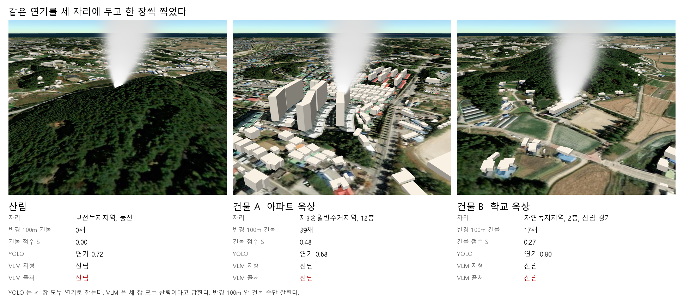

# 건물 위 연기와 산림 연기

같은 연기를 건물 옥상과 산림 한가운데에 두고 한 장씩 찍어, 사진만으로 둘을 가릴
수 있는지 보고 건물 위치를 넣으면 달라지는지 쟀다.

담당: 이예진 / 상태: 장면 3개로 측정 완료

## 왜 만들었나

2.4 학습 결과에서 헛탐지가 굴뚝연기, 안개연무, 구름 세 가지로 나왔고 그중
굴뚝연기가 가장 많았다. 굴뚝연기는 실제로 연기라서 사진만 봐서는 산불과 구분할
근거가 없다. 모델이 굴뚝연기에 매긴 신뢰도가 진짜 연기보다 높게 나온 경우도
있었다.

`docs/buildings.md`의 건물 데이터를 받은 이유가 이것이다. 그 데이터가 실제로
판정을 가르는지 확인한 것이 이 문서다.

## 장면 세 개

자리는 `tools/building_score.py`로 골랐다. 산림 자리는 반경 100m 안에 건물이 한
채도 없는 곳이고, 건물 자리는 그 건물 옥상이다.

| 장면 | 자리 | 용도지역 | 연기 시작 높이 |
|---|---|---|---|
| 산림 | 능선 | 보전녹지지역 | 지면 2m |
| 건물 A | 12층 건물 옥상 | 제3종일반주거지역 | 지면 36m |
| 건물 B | 2층 건물 옥상, 산림 경계 | 자연녹지지역 | 지면 6m |

촬영 조건은 셋 다 같다. 발화점에서 300m, 고도 120m, 기수 45도, 1024x820이다.

연기는 세 장 모두 같은 것을 썼다. **굴뚝 연기가 산불 연기와 모양이 어떻게 다른지
우리가 가진 데이터로는 모르기 때문에 다르게 지어내지 않았다.** 이것은 한계이고
아래에 다시 적는다.

## 결과



### 탐지로는 못 가린다

| 장면 | 상자 수 | 최고 신뢰도 | 연기 넓이비 |
|---|---|---|---|
| 산림 | 4 | 0.72 | 0.077 |
| 건물 A | 3 | 0.68 | 0.097 |
| 건물 B | 6 | 0.80 | 0.100 |

셋 다 연기로 잡는다. 건물 위에서 난 연기라고 해서 신뢰도가 낮아지지 않는다.

### VLM 도 못 가린다

전체 프레임을 넣었을 때다.

| 장면 | 연기 | 색 | 퍼짐 | 불꽃 | 지형 | 출처 | 밑동에 건물 |
|---|---|---|---|---|---|---|---|
| 산림 | 있음 | 검은색 | 넓음 | 없음 | 산림 | 산림 | 없음 |
| 건물 A | 있음 | 검은색 | 넓음 | 없음 | 산림 | 산림 | 없음 |
| 건물 B | 있음 | 흰색 | 넓음 | 없음 | 산림 | 산림 | 없음 |

**세 장이 거의 같은 답이다.** 건물 A는 아파트와 상가가 화면을 거의 다 채우고
산림이 구석에만 있는데도 지형을 산림이라고 답했다. 연기 밑동에 건물이 있는지
바로 물어도 세 장 다 없다고 답했고, 근거로 세 장 다 "연기 아래 나무가 보임"을
골랐다.

연기 색도 틀렸다. 화면의 연기는 흰색인데 여섯 번 중 다섯 번을 검은색이라고 했다.

### 자르면 쉬운 한 장이 바뀐다

7.2에서 고른 대로 탐지 영역만 여백 1배로 잘라 넣었다.

| 장면 | 출처 | 밑동에 건물 | 근거 |
|---|---|---|---|
| 산림 | 산림 | 없음 | 연기 아래 나무가 보임 |
| 건물 A | **건물** | **있음** | 연기 아래 건물이 보임 |
| 건물 B | 산림 | 없음 | 연기 아래 나무가 보임 |

건물 A는 맞혔다. 자르면 연기 밑동이 화면에서 커져서 그 아래 아파트 지붕이 보이기
때문으로 보인다. 건물 B는 자르고도 못 맞혔다. 산림 경계에 있는 2층 건물이라
잘라도 뒤에 산이 그대로 남는다.

지형은 자른 뒤에도 여섯 번 모두 산림이었다.

### 화면에 건물을 세우는 것은 답을 바꾸지 않는다

시뮬레이터에 세운 건물이 VLM 의 답에 쓰이는지 보려고, 건물을 끄고 같은 장면
세 개를 같은 조건으로 다시 찍어 같은 질문을 넣었다.

| 장면 | 건물 | 전체 프레임 출처 | 자른 사진 출처 |
|---|---|---|---|
| 산림 | 켬 | 산림 | 산림 |
| 산림 | 끔 | 산림 | 산림 |
| 아파트 옥상 | 켬 | 산림 | **건물** |
| 아파트 옥상 | 끔 | **건물** | 산림 |
| 학교 옥상 | 켬 | 산림 | 산림 |
| 학교 옥상 | 끔 | 산림 | 산림 |

**맞힌 한 번이 조건을 바꿀 때마다 자리를 옮긴다.** 건물을 켜면 자른 사진에서
맞히고 끄면 전체 프레임에서 맞힌다. 효과가 아니라 흔들림이다.

| | 적중 |
|---|---|
| 출처 질문 전체 | 6/12 |
| 건물 장면만 | **2/8** |
| 산림 장면만 | 4/4 |

산림을 4/4 로 맞히는 것은 읽어서가 아니라 거의 항상 산림이라고 답하기
때문이다. 그 답으로 고정하면 산림은 다 맞고 건물은 다 틀린다. 실제로 12번 중
10번이 산림이었다.

**화면에 건물을 세우는 것은 시연 그림을 맞추는 일이지 모델을 돕는 일이
아니다.** 연기를 12층 옥상에 피우면 지면에서 36m 인데, 건물이 없으면 연기가
공중에 떠 보인다. 그래서 남겨 두었다.

### 건물 위치는 갈린다

| 장면 | 10m | 30m | 50m | 100m |
|---|---|---|---|---|
| 산림 | 0채 | 0채 | 0채 | **0채** |
| 건물 A | 1채 | 3채 | 10채 | 39채 |
| 건물 B | 1채 | 5채 | 7채 | 17채 |

`building_score.py`의 점수 S다. 오차 반경 안에서 위치 후보를 고르게 뽑아 그중
건물에서 15m 안에 있는 후보의 비율이다.

| 장면 | 반경 10m | 반경 30m | 반경 50m | 반경 100m |
|---|---|---|---|---|
| 산림 | 0.00 | 0.00 | 0.00 | 0.00 |
| 건물 A | 1.00 | 0.49 | 0.46 | 0.48 |
| 건물 B | 1.00 | 0.70 | 0.42 | 0.27 |

산림 자리는 어느 반경에서도 0.00이다.

## 읽은 것

1. **탐지도 VLM 도 세 장을 같게 본다.** 사진만으로는 연기가 건물에서 났는지
   산림에서 났는지 가릴 수 없다
2. **VLM 의 지형 답이 산림에 고정된다.** 여섯 번 모두 산림이었고 아파트 단지도
   산림이라고 했다. 거리 추정에서 15장 중 14장이 150m 로 고정됐던 것과 같은
   모양이다
3. **자르면 쉬운 경우 하나가 바뀐다.** 12층 옥상은 맞혔고 산림 경계 2층은 못
   맞혔다. 자르기는 보조가 되지만 가름 수단은 아니다
4. **건물 수는 세 자리에서 갈린다.** 산림 자리만 반경 100m 안 0채다
5. **화면에 건물을 세워도 답은 안 바뀐다.** 켜고 끄고 재서 확인했다. 시연
   그림을 맞추는 일이고 모델을 돕는 일이 아니다

VLM 이 못 하는 판단을 건물 위치가 대신한다. 이 시연이 보이려던 것이 그것이다.

## 한계

- **장면이 세 개이고 손으로 골랐다.** 산림 자리는 반경 100m 안 건물 0채인
  곳에서 골랐으므로 가장 쉬운 경우다. `building_score.py` 주석에 적힌 36곳
  기준 정확도는 반경 100m 에서 56% 였고 찍기 기준선이 50% 였다. **이 세 장의
  깨끗한 차이를 규칙 전체의 성능으로 읽으면 안 된다**
- **같은 연기를 세 장에 썼다.** 실제 굴뚝 연기가 산불 연기와 눈으로 구분되는지는
  이 측정으로 알 수 없다. 2.4 의 헛탐지 통계가 구분이 어렵다는 쪽을 가리키지만
  그것은 다른 데이터다
- 시뮬레이터 화면이고 건물은 층수로 어림한 단색 박스다. 실제 드론 영상에서
  같은 결과가 나올지는 따로 재야 한다
- 전체 프레임 50초, 자른 사진 26에서 34초다. 7.2 에서 잰 9.2초보다 긴 것은 이
  프레임이 1024x820 이라 입력이 1,172토큰이고 자른 것도 631에서 830토큰이기
  때문이다. 7.2 는 886토큰과 188토큰이었다

## 다시 돌리는 법

연기 밑동 좌표와 높이는 `sim/index.html`의 `SCENES3`에 있다.

```
# 1. 시뮬레이터를 띄우고 콘솔에서 장면 세 개를 찍는다
python tools/sim_server.py sim 8712
#    브라우저 콘솔에서  await scenes3()

# 2. 탐지와 VLM
python tools/chimney_probe.py --frames 프레임폴더 --out results/chimney_full.csv

# 3. 건물 위치
python tools/building_score.py data/geo_moraegogae/buildings_summary.csv 지점csv 10 30 50 100
python tools/count_buildings.py data/geo_moraegogae/buildings_summary.csv 지점csv 10 30 50 100
```

`chimney_probe.py`는 llama-server 를 `--slot-save-path`와 함께 띄워 두어야 한다.
같은 사진을 거듭 넣으면 서버가 그림 임베딩을 재활용해 입력 토큰이 1 로 떨어지고
시간이 거짓으로 짧게 나온다.

## 남은 것

- 6.1 평가셋 100장이 나오면 자리를 손으로 고르지 않고 다시 재기
- 건물 B 처럼 산림 경계에 있는 건물을 여러 개 모아, 어디서부터 가릴 수 없게 되는지
  보기
- 실제 굴뚝연기 사진으로 같은 측정 해 보기
