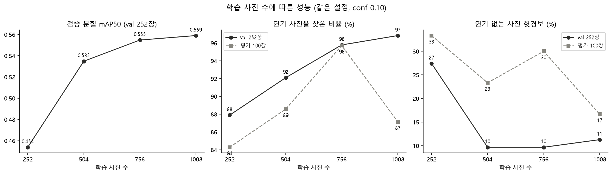

# 분할 모델 학습 결과 (WBS 2.4)

실제 데이터로 학습을 돌리고 무엇이 성능을 올리는지 확인한다. 데이터 양, 입력
해상도, 모델 크기를 하나씩 바꿔 가며 다섯 번 돌렸다.

담당: 이예진 / 상태: 완료. 운영 설정은 yolo11n-seg @ 960px, conf 0.10

## 재는 기준

mAP만으로는 쓸모를 알 수 없어서 사진 단위로도 잰다.

| 항목 | 뜻 |
|---|---|
| 작은 연기 | 정답 폴리곤이 화면의 0.2% 미만인 사진에서 연기를 찾은 비율 |
| 큰 연기 | 정답 폴리곤이 화면의 0.2% 이상인 사진에서 연기를 찾은 비율 |
| 배경 헛탐지 | 연기가 없는 사진에서 연기를 찾은 비율 |

0.2%를 기준으로 나눈 것은 300장 모델이 놓친 사진의 정답 넓이 중앙값이 0.171%,
찾은 사진이 0.852%로 갈렸기 때문이다. 검증 세트가 모델마다 다르므로 건수가 아니라
비율로 비교한다. 각 모델은 자기 검증 세트로 잰다.

## 데이터

| | 300장 | 1,260장 |
|---|---|---|
| 연기 | 270 | 950 |
| 배경 (구름, 굴뚝연기, 안개연무) | 30 | 310 |
| 학습 / 검증 | 240 / 60 | 1,008 / 252 |
| 연기 객체 수 | 318 | 1,278 |

선별 규칙은 `docs/data_select.md`와 같다. 영상 하나에서 1장만 쓰고, 시연 지역을
빼고, 영상 단위로 학습과 검증을 나눈다. 300장에서 1,260장으로 늘릴 때 분류별
장수만 바꿨다.

## 다섯 번 돌린 결과

학습 곡선에서 분할 mAP50이 가장 높았던 지점이다.

| 사진 | 모델 | 해상도 | 배치 | 에폭 | 최고 | 분할 mAP50 | 박스 mAP50 | mAP50-95 |
|---|---|---|---|---|---|---|---|---|
| 300 | yolo11n | 640 | 16 | 100 | 73 | 0.298 | 0.296 | 0.079 |
| 1,260 | yolo11n | 640 | 16 | 91 | 60 | 0.544 | 0.565 | 0.183 |
| 1,260 | yolo11n | 960 | 8 | 100 | 88 | 0.559 | 0.550 | 0.192 |
| 1,260 | yolo11n | 1280 | 4 | 100 | 89 | 0.611 | 0.595 | 0.222 |
| 1,260 | yolo11s | 640 | 8 | 100 | 89 | 0.510 | 0.538 | 0.183 |

1,260장 640px은 91에폭에서 멈췄다. 최고점이 60에폭이고 그 뒤로 내려가고 있었으므로
100까지 갔어도 크게 다르지 않았을 것이다.

사진 단위로 잰 값이다. conf 0.25 기준이다.

| 사진 | 모델 | 해상도 | 작은 연기 | 큰 연기 | 배경 헛탐지 |
|---|---|---|---|---|---|
| 300 | yolo11n | 640 | 7/15 (47%) | 34/39 (87%) | 3/6 (50%) |
| 1,260 | yolo11n | 640 | 35/56 (62%) | 124/134 (93%) | 6/62 (10%) |
| 1,260 | yolo11n | 960 | 43/56 (77%) | 131/134 (98%) | 2/62 (3%) |
| 1,260 | yolo11n | 1280 | 43/56 (77%) | 124/134 (93%) | 2/62 (3%) |
| 1,260 | yolo11s | 640 | 52/56 (93%) | 130/134 (97%) | 8/62 (13%) |

### 데이터를 늘린 것이 가장 크게 들었다

300장에서 1,260장으로 늘리자 작은 연기가 47%에서 62%로, 배경 헛탐지가 50%에서
10%로 바뀌었다. 300장일 때 배경이 분류마다 10장씩뿐이어서 굴뚝연기와 안개연무를
구분할 근거가 없었다.

300장 모델은 60에폭에서 곡선이 평평해졌고 그 뒤 40에폭 동안 0.21에서 0.28 사이를
오갔다. 에폭을 늘리는 것은 답이 아니었다.

### 해상도는 960에서 꺾였다

| 바꾼 것 | 작은 연기 | 배경 헛탐지 | mAP50-95 |
|---|---|---|---|
| 640 -> 960 | 62% -> 77% | 10% -> 3% | 0.183 -> 0.192 |
| 960 -> 1280 | 77% -> 77% | 3% -> 3% | 0.192 -> 0.222 |

960까지는 탐지율이 올랐고, 960에서 1280으로는 마스크 품질만 올랐다. 원본이
3840x2160이라 640으로 줄이면 화면의 0.016%짜리 연기가 6x6 픽셀이 된다. 960으로
올리면 그만큼 살아난다.

1280은 추론이 20.2ms로 960의 7.0ms보다 3배 느린데 탐지율은 같다. 엣지에서 돌릴
것이므로 960을 쓴다. `evidence.area_ratio`로 연기 크기를 정확히 재야 할 일이
생기면 그때 1280을 다시 본다.

mAP만 봤으면 960의 값어치를 놓칠 뻔했다. 960은 640보다 분할 mAP50이 0.015밖에 안
올랐는데 작은 연기는 15%p 올랐다. 작은 연기는 객체 수가 적고 면적도 작아 mAP에
거의 기여하지 못한다.

### 모델을 키운 것은 안 들었다

yolo11s는 파라미터가 10.11M으로 yolo11n의 2.88M보다 3.5배인데 분할 mAP50이 0.510
으로 더 낮았다. conf 0.25에서 작은 연기를 93% 찾아 한때 더 좋아 보였으나, 배경
헛탐지가 13%였다. 더 민감해진 것이지 더 정확해진 것이 아니다.

헛탐지율을 맞춰 놓고 비교하면 이렇다.

| 배경 헛탐지 | yolo11n @960 | yolo11s @640 |
|---|---|---|
| 약 2% | 73% (conf 0.30) | 54% (conf 0.50) |
| 약 11% | 96% (conf 0.10) | 91% (conf 0.30) |
| 약 19% | 98% (conf 0.05) | 96% (conf 0.15) |

모든 지점에서 yolo11n이 앞선다. 1,260장으로 10M 파라미터를 채우기에는 데이터가
모자란 것으로 본다. 배치가 16과 8로 달랐던 것도 조금 작용했겠으나 뒤집힐 차이는
아니다.

`docs/seg_candidates.md`에 적어 둔 "7주차에 n과 s를 학습해 비교한다"가 이것이다.

## 운영 문턱

yolo11n @960의 문턱별 성능이다.

| 문턱 | 작은 연기 | 큰 연기 | 배경 헛탐지 |
|---|---|---|---|
| 0.05 | 55/56 (98%) | 134/134 (100%) | 12/62 (19%) |
| 0.10 | 54/56 (96%) | 133/134 (99%) | 7/62 (11%) |
| 0.20 | 46/56 (82%) | 131/134 (98%) | 4/62 (6%) |
| 0.25 | 43/56 (77%) | 131/134 (98%) | 2/62 (3%) |
| 0.30 | 41/56 (73%) | 130/134 (97%) | 1/62 (2%) |
| 0.40 | 36/56 (64%) | 126/134 (94%) | 0/62 (0%) |

헛탐지가 어느 분류에서 나오는지 나눠 보면 이렇다.

| 문턱 | 구름 | 굴뚝연기 | 안개연무 | 합계 |
|---|---|---|---|---|
| 0.05 | 2/26 | 6/20 | 4/16 | 12/62 |
| 0.10 | 0/26 | 5/20 | 2/16 | 7/62 |
| 0.20 | 0/26 | 3/20 | 1/16 | 4/62 |
| 0.25 | 0/26 | 1/20 | 1/16 | 2/62 |
| 0.40 | 0/26 | 0/20 | 0/16 | 0/62 |

**conf 0.10에서 구름 26장은 한 장도 틀리지 않는다.** 문턱을 내려도 평범한 풍경에서
알람이 늘지 않고, 진짜로 연기처럼 생긴 것에서만 늘어난다는 뜻이다.

지금 `predict_seg.py`의 `DET_CONF` 기본값은 0.25다. 이 값은 헛탐지를 탐지 단계에서
막는다는 전제로 잡은 것이다. 재난 상황에서는 놓치는 쪽이 더 나쁘고, 헛탐지는 뒤의
지리 결합과 사람 확인으로 거를 수 있다. **0.10으로 내리면 작은 연기가 77%에서
96%로 오른다.**

굴뚝연기 5건은 건물 데이터로 거를 여지가 있다(`docs/buildings.md`). 안개연무 2건은
거를 방법이 없다. 안개 2건 때문에 작은 연기 19%p를 버리는 것은 맞지 않다.

## 학습 시간과 메모리

RTX 3050 Laptop 4GB, 여유 VRAM 3.23GB 기준이다.

| 모델 | 해상도 | 배치 | 최대 VRAM | 100에폭 | 추론 |
|---|---|---|---|---|---|
| yolo11n | 640 | 16 | 2.51GB | 18.1분 | - |
| yolo11n | 960 | 8 | 3.11GB | 62분 | 7.0ms |
| yolo11n | 1280 | 4 | 2.77GB | 148.0분 | 20.2ms |
| yolo11s | 640 | 8 | 2.42GB | 76.2분 | 13.1ms |

1280에서 배치를 4로 내리니 960 배치 8보다 메모리를 덜 썼다. 해상도보다 배치가
메모리에 더 크게 작용한다.

### 데이터 로더 워커가 병목이었다

처음에는 `workers=0`이었다. Windows에서 데이터 로더가 프로세스를 새로 띄우는 문제를
피하려고 넣은 값인데, main 가드가 있으면 워커를 써도 안전하다.

워커 0으로 돌리면 메인 스레드가 혼자 사진을 읽는다. mosaic 증강이 샘플 하나에 사진
4장을 읽으므로 GPU가 데이터를 기다리며 논다. 학습을 중단했을 때 `cv2.imdecode`
안에서 멈춰 있었다.

**640px 240장 기준으로 에폭당 56초에서 5.7초로 줄었다.** 워커를 띄우는 비용은 첫
에폭에만 든다. `tools/train_seg.py`의 다섯 번째 인자로 받고 기본값은 4다.

### Colab은 필요 없다

`docs/train_setup.md`에 실제 학습은 Colab에서 한다고 적어 두었는데, 4GB로 어려울까
걱정해서였다. 실제로는 1,260장 960px 100에폭이 62분이다. 노트북에서 돌리면 된다.

### 이어서 돌리기

학습이 두 번 끊겼다. 에폭마다 `last.pt`에 옵티마이저 상태와 에폭 번호가 저장되고
같은 폴더의 `args.yaml`에 설정이 남으므로, 끊긴 다음 에폭부터 이어 갈 수 있다.

```
python -c "from ultralytics import YOLO; YOLO('runs/smoke/weights/last.pt').train(resume=True)"
```

## 쓸 수 있는 데이터의 상한

71330 Validation 드론 촬영분은 14,067장이다. 영상 하나에서 1장만 쓰므로 상한은
사진 수가 아니라 영상 수다.

| 분류 | 쓴 것 | 시연 지역 뺀 영상 |
|---|---|---|
| 백색회색연기 | 600 | 727 |
| 흑색연기 | 350 | 412 |
| 구름 | 130 | 191 |
| 굴뚝연기 | 100 | 127 |
| 안개연무 | 80 | 99 |
| 합계 | 1,260 | 1,556 |

화염 영상에서 연기 라벨이 함께 있는 프레임을 더해도 시연 지역을 빼면 영상 45개가
늘어 1,601장이 상한이다. 지금 1,260장은 그 79%다. 더 늘려도 1.27배라 300장에서
1,260장으로 갈 때(4.2배)만큼의 변화는 기대하기 어렵다.

Training 분할은 원천데이터가 588GB(TS.z01~z05 + TS.zip)라 받을 수 없다. 라벨
(TL.zip)은 1GB지만 이미지 없이는 쓸 수 없다.

## 큰 연기를 섞은 재학습 (11주차, 채택 안 함)

번진 산불처럼 화면을 넓게 덮는 연기를 지금 모델이 연기 가장자리 띠로만 잡았다
(시뮬레이터 연기 벽 장면, docs/demo_area.md). 학습 1,260장이 작은 초기 연기 위주라서다.
71330 검증 라벨에서 연기 면적이 화면의 8% 이상인 사진 600장(드론 36, 지상 564)을
골라(`tools/select_large_smoke.py`) 섞어 보았다. 학습에 쓰지 않은 큰 연기 119장을
따로 떼어 평가셋(large_val)으로 썼다.

네 가지로 돌렸고 모두 운영 문턱 conf 0.10에서 쟀다.

| | 옛 모델 | 처음부터 +481장 | 처음부터 +240장 | 미세조정 lr 3e-4, 30에폭 | 미세조정 lr 1e-4, 10에폭 |
|---|---|---|---|---|---|
| 큰 연기 119장 (사진 재현율) | 98 | 118 | 118 | 118 | 117~119 |
| 큰 연기 마스크 IoU | 0.47 | 0.71 | 0.69 | 0.69 | - |
| val_252 연기 190장 | **184** | 170 | 177 | 176 | 172~177 |
| val_252 작은 연기 53장 | **49** | 41 | 45 | 45 | - |
| val_252 헛경보 62장 | 7 | 3 | 8 | 9 | 10~15 |
| eval_100 연기 70장 | 61 | 54 | 57 | 63 | - |
| eval_100 헛경보 30장 | 5 | 3 | 9 | 2 | - |
| 시뮬레이터 접근 장면 57장 | **49** | 34 | 26 | 42 | - |
| 접근 장면 첫 탐지 거리 | **880m** | - | - | 790m | 775~850m |

미세조정은 지금 모델에서 출발해 학습률만 낮춘 것이다. 마지막 칸은 에폭마다 저장해
1, 3, 5, 7, 9에폭을 모두 잰 범위다.

미리 정한 교체 기준(val_252 182장 이상, 첫 탐지 850m 이상, 큰 연기 110장 이상)을
넘은 모델이 없어서 **지금 모델을 그대로 쓴다.**

- 큰 연기는 쉽게 배운다. 240장만 넣어도, 미세조정 1에폭만 지나도 98장 → 117장이 된다.
  마스크도 연기 기둥 전체를 덮게 된다
- 그 대신 바로 작은 연기와 먼 거리 감도가 떨어진다. 넣는 양, 학습률, 멈추는 에폭을
  바꿔도 이 맞바꿈은 풀리지 않았다. yolo11n 크기에서 두 가지를 같이 잘하기는 어렵다고 본다
- 시뮬레이터의 연기 벽은 미세조정 모델로도 가장자리 띠만 잡힌다(띠가 넓어질 뿐).
  속까지 균일하게 하얀 시뮬레이터 연기 탓도 있어 실제 사진 결과(119장 중 118장)와 따로 봐야 한다

다시 돌리는 법

```
python tools/select_large_smoke.py <VL.zip> docs/select_large_smoke.csv --min-ratio 0.08
python tools/extract_71330.py docs/select_large_smoke.csv <VS.zip> <VL.zip> data/large_smoke
python tools/make_mix_dataset.py docs/select_large_smoke.csv <VL.zip> data/large_smoke data/yolo_mix
python tools/train_seg.py data/yolo_mix/dataset.yaml 100 960 8 4
```

`extract_71330.py`는 VL.zip의 한글 이름을 읽지 못해 라벨을 0장 꺼낸다. 사진만 쓰고
라벨은 `make_mix_dataset.py`가 VL.zip에서 직접 읽는다. 미세조정은 ultralytics를 직접
불러 `YOLO(지금 모델).train(lr0=0.0003, lrf=0.1, epochs=30, warmup_epochs=1)`로 돌렸다.
검증은 val_252만 써서 원래 감도 기준으로 best.pt가 골라지게 했다.

## 학습 사진 수에 따른 성능 (11주차)

위 상한 계산이 맞는지 보려고 학습 사진을 줄여 가며 같은 설정(yolo11n-seg, 960px,
배치 8, 100에폭, seed 0)으로 다시 학습했다. 분류 비율을 지켜 뽑았고 25%는 50%에,
50%는 75%에 들어가게 했다. 100%는 지금 운영 모델이다. 모두 conf 0.10에서 쟀다.

| 학습 사진 | 252 (25%) | 504 (50%) | 756 (75%) | 1,008 (100%) |
|---|---|---|---|---|
| 검증 분할 mAP50 | 0.454 | 0.535 | 0.555 | 0.559 |
| val_252 연기 190장 | 167 | 175 | 182 | 184 |
| val_252 작은 연기 53장 | 42 | 44 | 50 | 49 |
| val_252 큰 연기 137장 | 125 | 131 | 132 | 135 |
| val_252 헛경보 62장 | 17 | 6 | 6 | 7 |
| eval_100 연기 70장 | 59 | 62 | 67 | 61 |
| eval_100 헛경보 30장 | 10 | 7 | 9 | 5 |



- 252장 → 504장에서 mAP50이 0.08 오르고 헛경보가 17장 → 6장으로 줄었다. 그 뒤로는
  756장에서 0.020, 1,008장에서 0.004만 올랐다. 곡선이 거의 평평해졌다
- 그래서 상한인 1,601장까지 늘려도 크게 나아지기는 어렵다. 앞 절의 예상과 맞는다.
  더 나아지려면 사진 수보다 사진 종류(평범한 프레임, 큰 연기)나 모델 크기를 바꿔야 한다
- eval_100은 75%가 67장으로 100%(61장)보다 많이 찾았지만 헛경보도 9장으로 많았다.
  연기 사진 1장이 1.4%p, 배경 1장이 3.3%p라 이 정도 차이는 문턱 근처 몇 장으로 갈린다.
  추세는 사진 수가 더 많은 val_252로 본다
- 한 번씩만 돌려서(seed 0) 같은 크기 안의 흔들림은 재지 않았다

다시 돌리는 법: `python tools/data_size_curve.py` (25, 50, 75% 학습과 평가, 약 4시간),
그림은 `python tools/report_figs.py size`.

## 한계

- **평범한 프레임이 데이터에 없다.** 검증용 배경 62장이 전부 NegativeDB(구름 26,
  굴뚝연기 20, 안개연무 16)로 일부러 어려운 것만 모은 집합이다. 연기 영상의 드론
  촬영 프레임 5,750장을 모두 열어 보았으나 라벨이 빈 프레임은 0개였다. 71330은
  모든 사진에 무언가가 들어 있게 만들어져 있다. 실제 운용에서 아무 일도 없는
  프레임이 얼마나 헛알람을 내는지는 시연 지역에서 직접 찍은 영상으로 재야 한다
- 검증 세트의 연기 객체가 244개다. 비율 하나가 몇 장에 좌우된다
- 비교한 후보가 모두 YOLO 계열이다. 연기처럼 경계가 흐릿한 대상에는 개체 분할보다
  의미 분할이 맞을 수 있는데 재 보지 않았다. 실제로 연기 덩어리 하나를 세 조각으로
  쪼개서 낸 경우가 있었다

## 다시 돌리는 법

```
python tools/train_seg.py data/yolo_1260/dataset.yaml 100 960 8 4
python tools/predict_seg.py runs/smoke/weights/best.pt data/pilot
```

`SEG_MODEL`로 사전학습 가중치를, `DET_CONF`로 탐지 문턱을 바꾼다.
